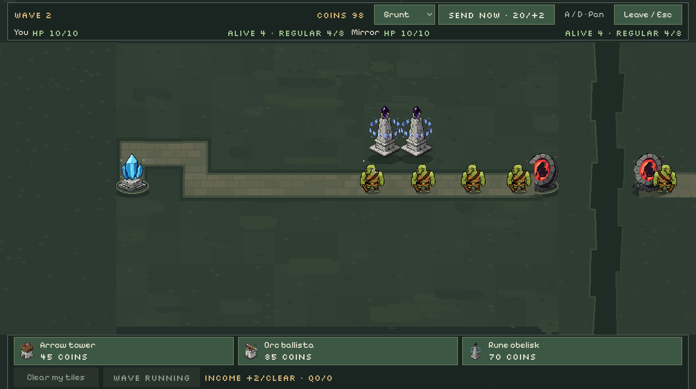

# TODO — Visual direction and gameplay roadmap

## Status and reference

- [x] Creator approved the direction of the board composition study on 2026-10-14.
- [x] Implement the approved presentation in the running game using existing artwork; coherent replacements remain approval-gated below.

This is a **static composition study, not an implemented game screenshot**. Approval covers the overall look: stronger proportions, more grounded sprites, layered terrain/path materials, and quieter highlights. It does not mean every existing sprite is final or that the exact camera angle has been settled. The study retains the supplied HUD, two owned Rune towers, four owned Grunts, one opponent Grunt, and the bent-route concept; no extra combat population was added to make it look fuller.

The portable reference is copied unchanged from `~/Pictures/Gorcs-PixelArt/board-readability-pass/board-target.png`. The original study directory also retains its detail image and `provenance.json`. Reference artwork is excluded from Godot imports and is not a runtime asset.

## Recommended viewing angle

**Validate an elevated, front-dominant oblique view for structures:** a broad front face, a narrower visible right side, and enough roof to convey depth. This is the creator's latest working preference from the 2026-10-14 sprite discussion; replacement artwork is not yet approved.

- Keep the existing axis-aligned square grid and 2D gameplay camera. This is a sprite-art direction, not a conversion to a diamond/isometric map or a 3D camera.
- Avoid both equal-sided corner-on foundations and flat front-elevation cutouts. Keep the front foundation edge broadly horizontal; reveal a smaller side face and visible top surfaces.
- Show an enemy's head/shoulders from above while retaining a readable face, torso, and legs. Avoid a pure side-view platformer pose.
- Share camera elevation, ground plane, light direction, shadow treatment, outline weight, and apparent pixel density. Matching angle does **not** require identical facing: structure bases stay fixed while directional weapons and enemies turn.
- Small readability cheats are acceptable. Mixing genuinely side-on towers with strict overhead enemies is not the target; they should look as if they occupy the same world.
- Do not switch to strict bird's-eye sprites unless that alternative is explicitly chosen after comparison. It sacrifices the faces and tall building silhouettes that work in the approved study.

## Approved presentation goals

- **Proportions:** towers read as substantial structures, not inventory icons beside enemies. Ground sprites by their feet/base rather than equal square image canvases. Grunt, Runner, and Brute remain distinguishable by silhouette and mass. The study's tower/Grunt sizing is a starting visual ratio, not a hardcoded global pixel size.
- **Density:** improve visual weight, material variation, and framing instead of adding enemies or towers to hide empty space. Preserve buildable-ground readability. Larger decoration belongs outside playable cells; cosmetic texture must not imply new blocked cells.
- **Ground and path:** replace the uniform dark field and flat bright path ribbon with restrained grass/soil variation, continuous stonework, subtle edges, and contact shadows. Corners, branches, portals, and bases must remain legible.
- **Highlights:** no permanent boxes around every tower and no idle combat hover square when there is no placement action. Give the selected tower contextual feedback; keep legal placement and range feedback discoverable. Show enemy health when damaged rather than drawing bright full bars over the whole stream. Make attack feedback brief, local, and subordinate to the units instead of overlapping gold rings that resemble persistent range indicators.
- **Art consistency:** the current Rune and Grunt still differ in perspective/detail density. Increasing size alone does not make them a matched set. Evaluate all art together on the board, not as isolated enlarged PNGs.

## Implementation order

### 1. Presentation pass using existing artwork

- [x] Establish resource-driven visual sizing and base/foot anchors for towers and enemies; avoid a one-size-fits-all canvas fit.
- [x] Apply the approved tower/enemy hierarchy without changing tower footprints, placement cells, hit rules, range, or path legality.
- [x] Add restrained terrain/path materials and grounding shadows; retain continuous path junctions and readable endpoints.
- [x] Remove always-on tower rectangles and irrelevant idle combat hover outlines; preserve explicit selection, placement legality, and selected range feedback.
- [x] Limit routine health-bar clutter and replace overpowering attack highlights with clearer transient effects. Keep damage/AoE information understandable.
- [x] Keep the fixed HUD, compact-width usability, local camera scouting, and opponent read-only input intact.

The creator's `swappy-20261014_211722.png` rejected the first pass's weak board/exterior separation and redundant HUD prose. The corrected runtime now has a distinct playable field, darker exterior, external earth rim, continuous jagged central ravine, broad quiet terrain patches, and orderly stone paths. Repeated Not ready/Route missing, opponent planning budgets, always-on pan instructions, zero income/queues, disabled wave captions, duplicate placement title/price, and inline affordability prose are removed or moved into tooltips. Positive gameplay state and actual controls remain available.

### 2. Coherent sprite pass

- [x] Make an actual-game-size lineup of Grunt, Runner, Brute, Arrow, Ballista, Rune, portal, and crystal against the proposed terrain. Choose one camera-elevation/light/pixel-detail standard from that lineup.
- [ ] Refine mismatched assets against that shared scene reference; do not generate each asset with an independent style or camera prompt.
- [ ] Preserve original PNGs and provenance; obtain approval for replacements before importing them. Follow the [sprite pipeline](docs/sprite-pipeline.md#approval-and-game-integration).
- [x] Verify source-facing metadata and mirrored-board facing. Start with usable still poses; decide directional poses and animation separately rather than claiming a still is a walk cycle.

The [full actual-size lineup](docs/visual-reference/asset-lineup.png) and [provenance](docs/visual-reference/asset-lineup.provenance.json) use original artwork together against the proposed terrain. This is a **static composite**, not runtime proof. The working standard is elevated three-quarter forms, upper-left lighting, dark readable contours, restrained contact shadows, and deliberate pixel clusters. Runner's head/shoulder planes, Brute's frontal pose, and Rune's finer detail remain visible mismatches.

Two shared-scene ComfyUI refinement batches produced Runner/Brute alternatives at `~/Pictures/Gorcs-PixelArt/asset-lineup-20261014/`, with original PNGs, references, raw outputs, exact requests/history, seeds, processing scripts, and hashes preserved. The candidates are not imported or approved. They improve some perspective cues but still have finer shading/bright contour flecks than Grunt; refinement and replacement approval remain unchecked.

Creator chose **Keep current sprites** for the initial presentation change. Existing runtime artwork remains installed; no replacement is approved by that decision. Continuing refinement produced two new shared-scene seed proposals under `~/Pictures/Gorcs-PixelArt/asset-lineup-20261014/coherent-refinement/`, with graphs, histories, raw outputs, source-facing/anchor metadata, cleanup scripts, and hashes preserved. `candidate-identity-locked-comparison.png` is the preferred review: seed-one Runner/Brute with an explicitly labelled CPU simplification of the original level-one Rune. Model-generated Rune architecture drift was rejected, not substituted for the accepted sprite. Brute interior detail and Rune density still need judgment; this is a static still-pose proposal, not installed art or animation. Refinement/approval boxes remain unchecked.

Portable review artifacts: [shared-scene candidate comparison](docs/visual-reference/coherent-candidates.png) and [provenance](docs/visual-reference/coherent-candidates.provenance.json). These are unapproved static proposals, kept outside Godot imports; the updated original-asset lineup uses the corrected terrain palette.

Gold Mine and Lightning exceptions (2026-10-17): the creator approved and requested installation of both reference-free GameLab stills. Only their base sprites are replaced; originals and generation provenance are archived. Their visible widths remain approximately 0.98 cells, and existing evolution anchors/art remain unchanged. Lightning's runtime canvas is losslessly reframed to preserve its shared electric muzzle coordinates, with the approved taller silhouette retained. Isolated actual-main-scene Wayland/Mesa walkthroughs exercised pointer placement/inspection, both orientations at standard/compact widths, adjacent towers, top-row Lightning clearance, and accepted live chain fire. Rendered board/icon regressions passed. This is not roster-wide approval; War Drums remains procedural and Ballista's later trial is recorded below.

### 3. Structure perspective and Ballista — provisional directional game trial

The creator preferred the original heavy crossbow over a front-facing masonry base, but rejected that rough composite's quality. The later `swappy-20261014_223240.png` sketch supersedes the completely frontal box in `swappy-20261014_223203.png`: retain a broad front wall, show a narrower right wall, and reveal more roof. The earlier equal-sided corner-facing appearance in `swappy-20261014_215908.png` is not the target. These references are local Desktop screenshots; the geometry description here is the portable direction.

**Current trial (2026-10-17):** the creator approved a new reference-free GameLab SE Ballista design, then all seven reference-guided weapon directions, and authorized trying the assembled set in-game. The shared 192×192 base/socket and weapon layers are installed; a complete SE still supplies collection/chest/shop/guide art. The requested separately generated empty base failed with insufficient provider credits, so this explicitly provisional trial retains the manually reconstructed roof rather than claiming a newly generated base.

Sources, previous runtime PNG, prompts/job IDs, reproducible alignment, shared palette, per-direction release tips and actual game captures are in the [GameLab Ballista archive](archive_assets/README.md#provisional-directional-ballista-game-trial). The fixed foundation remains approximately 1.10 cells wide with one foot anchor; camera clearance includes every pose. Gameplay footprints, target policy, stats, saved identity and authority are unchanged.

The [earlier manual starting image](archive_assets/towers/ballista/manual-master/ballista.png) and its separate base/crossbow remain historical alternatives, not the current runtime set. The older creator-led PixelLab rotation handoff has been superseded by the explicit GameLab generation/trial request.

#### Artwork changes

- [x] Refine one ballista starting pose around the approved taller buttressed base, preserving the recognizable heavy timber crossbow, pale stone, steel fittings, upper-left light, and dark contours. Add steel bindings, stock highlights, a windlass, and rivets without enlarging the weapon.
- [x] Produce **eight distinct crossbow poses: N, NE, E, SE, S, SW, W, NW** from the approved GameLab master; all seven generated alternatives received creator design approval.
- [x] Keep the **base identical in every pose**. Runtime renders one fixed base and one weapon layer; masonry and light direction never mirror or rotate.
- [x] Align the approved views on a shared 192×192 canvas, swivel `(96, 84)` and foot `(96, 157)`, with nearest-neighbor perspective normalization, master-palette matching and detached support cleanup. No finished PNG is rotated in its image plane.
- [ ] Apply the same accepted structure perspective to the other towers, crystal pedestal, and portal rim. Preserve crystal facets and portal-opening readability; do not change the square-grid map or gameplay camera to accommodate sprites.
- [ ] Final creator judgment of the provisional reconstructed roof and cross-view weapon proportions after playtesting; a separately generated empty base remains credit-blocked. Original images, exact processing and stable collection/save identities are already preserved.

#### Game additions

- [x] Add resource-driven directional weapon layers and bolt-tip origins over a fixed base; retain an SE still icon for collection/chest/UI surfaces.
- [x] Track only the **host-selected enemy** through logical interpolation while it is alive and in range. Missing/dead/out-of-range targets retain host-captured aim; never-aimed towers rest SE. Release origins use the accepted shot aim, not later target movement or a client-local nearest enemy.
- [x] Select all eight displayed directions on mirrored and normal boards while retaining stationary masonry, footing, depth, selection and all-pose camera headroom.
- [x] Exercise all eight directions in separate authenticated rendered host/client main scenes at exact 1280×720 and 1000×720 viewports, including top-row/adjacent towers and accepted live bolts. Persistent peer regressions cover moving accepted targets, closer decoys, absent/dead/out-of-range fallback and immutable released projectiles; rendered board/icon and catalog checks cover geometry and validation.

#### Earlier experiments (archived)

The earlier pre-GameLab experiments were stopped without importing their replacement sprites or implementing tracking. Those eight full-pose generations and isolated weapon candidates remain unapproved and are not the source of the installed GameLab trial. The south full-pose generation was oversized; other observed issues included inconsistent bow/stock/string geometry, mount gaps, and a detached west fragment.

- Initial rough front-facing studies: `~/Pictures/Gorcs-PixelArt/ballista-facing-experiment/`.
- Later generations, direction references, requests/history, and draft assemblies: `~/Pictures/Gorcs-PixelArt/ballista-eight-directions-v2/`.
- `generated-full-poses-review.png` shows the eight generated full poses; `eight-pose-assembly-review.png` shows the unfinished shared-base assembly.
- `base-oblique-01-native_00001_.png` is the unapproved sketch-led base candidate with a narrower visible right side. Later weapon refinement outputs still need review; do not treat a completed generation as approved artwork.

### 4. Verification and acceptance

- [x] Exercise the actual game at 1280×720 and 1000×720, on both board orientations and while panning, with representative bent paths and adjacent towers.
- [x] Inspect idle, hover, placement, selection, attacks, damaged/full health, mixed-enemy streams, and crowded combat. Check overlap, depth sorting, clipping, and health/endpoint visibility.
- [x] Compare a real gameplay capture against the approved reference with comparable counts and layout. Do not present a static composite as runtime proof.
- [x] Run applicable checks from [development](docs/development.md#setup); preserve authoritative gameplay/network state and update affected behavior regressions where needed.
- [x] Update current-state documentation only after implementation and visual verification; keep these boxes unchecked until their behavior is actually delivered.

Current corrected runtime evidence: [1280×720 empty board separation](docs/visual-reference/gameplay-empty.png), [1280×720 bent path and adjacent Rune towers](docs/visual-reference/gameplay-presentation.png), [1000×720 mixed combat](docs/visual-reference/gameplay-compact.png), and [1000×720 top-row towers clearing the HUD](docs/visual-reference/gameplay-top-row.png). These direct Godot main-scene viewport captures replace the first material/HUD pass; they are not composites. Regular enemy count/spawn spacing, board dimensions, placement/hit rules, range, and authoritative state are unchanged. See [verification details](docs/development.md#match-soundtrack-and-presentation).

## Scope boundaries

The visual-direction work above does not authorize balance changes, extra regular enemies, different spawn spacing, new gameplay footprints, a larger map, more path budget, new enemy mechanics, or replacing the approved HUD wholesale. Visual size is not simulation size. Generated artwork remains subject to the existing approval/provenance workflow. The separately agreed gameplay roadmap below has its own scope.

## Gameplay roadmap — loadouts, tower rolls, and roster expansion

Agreed design from the planning discussion, now implemented with authored **provisional** parameters except two boundaries: undecided final Lightning identity/additional evolutions, and unverified battlefield visual surfaces. Graphical testing was stopped during implementation and subsequently permitted for Towerieary. Existing Arrow, Ballista, and Rune behavior is preserved except where these systems explicitly extend it. Checked mechanics are supported by source and headless behavior/control/real-peer proof, **not** new battlefield pixel or final-balance approval. See [current verification](docs/development.md#six-role-gameplay-verification) and [authoring contracts](docs/content-pipeline.md#six-role-schemas-and-evolution-data).

### Loadouts and collection

- [x] Expand the roster to six collectible tower identities: Arrow, Ballista, Rune, Lightning (working name), War Drums, and Gold Mine.
- [x] Let each player equip up to four distinct tower types from their collection. Allow empty slots, but require a nonempty loadout.
- [x] Give fresh collections Arrow as a guaranteed starter. Atomically migrate existing saves without losing unlocks; reset also retains the starter guarantee.
- [x] Add loadout selection together in the connected lobby, before initial board planning. Do not expose the opponent's loadout list; recipient-targeted snapshots reveal only their own original deck and opponent commitment status, while placed towers remain scoutable.
- [x] Make the committed loadout constrain host-validated purchases, not just the palette. Singleplayer selects/commits before boards and returns to selection on replay. Guest local-save ownership remains a trusted-friends claim, not account/save attestation; host-enforced admitted IDs are frozen.
- [x] Keep evolution branches within their parent tower's loadout slot.

### Per-placement rarity and attributes

- [x] Roll each individual tower's rarity and attributes when its paid placement succeeds. The player chooses the tower identity, not an unknown tower summon.
- [x] Use this rarity ladder: Broken → Shoddy → Common → Uncommon → Rare → Epic → Legendary → Mythic.
- [x] Author placement rarity weights and, for every rarity/profile, positive-slot count, drawback-slot count, eligible pools, and attribute value bounds. Lowest tiers have only drawbacks; all authored values remain provisional.
- [x] Restrict pools to tower-compatible effects. No duplicate attributes on one tower and no opposing positive/negative modifiers to the same stat.
- [x] Support numerical modifiers and mechanical effects. Illustrative outcomes remain Common Rune with +5% attack speed and −3% damage; Legendary Ballista with +33% damage and +1 bounce; Mythic Rune with increased range. These examples are not approved odds, bounds, or slot counts.
- [x] Preserve all rolled attributes through purchased evolutions. Pools/effect definitions are compatible with each implemented future branch; effective stats rederive from purchased baselines rather than compounding previous rolls.
- [x] Stack rolled mechanics additively with purchased mechanics: extra Pierce adds capacity to Pierce; extra Bounce grants bouncing independently and adds to Bounce. Rune cannot roll Ballista-specific Pierce/Bounce.
- [x] Apply the result immediately and show rarity/attributes in inspection. No pre-purchase roll preview, choice-of-offers flow, or reveal modal. Signed range rolls change usable tiles with positive ceil/negative floor rounding, zero preserving authored range.
- [x] Keep rarity, attributes, and reroll state run-specific; placed towers are not permanent collection items.

### Rerolls and run-only currency

- [x] Add two separate tower actions: reroll rarity and reroll attributes.
- [x] Rarity rerolls spend run-only Shards, exclude the current tier, renormalize the same placement weights, roll a different tier, and regenerate all attributes. Downgrades are allowed.
- [x] Attribute rerolls cost match Coins, retain rarity, and regenerate every attribute and value, not a selected attribute or values alone.
- [x] Give each tower independent rarity/attribute counters. Costs use `ceil(base + linear*n + quadratic*n²)`, not stepped brackets; provisional curves are `(8,4,2)` Shards and `(20,10,5)` Coins.
- [x] Every rarity reroll resets the attribute cost counter but never its own rarity counter.
- [x] Permit rerolls during planning/combat wherever tower management is allowed. Committed Ready locks rerolls until combat starts.
- [x] Award Shards on round clears and random enemy drops; enemy resources define chance/payout. Prototype starting/clear grants are provisionally 8/3, separate from Coins.
- [x] Allow every enemy type, sent enemies, and summoned SkeleOrcs to drop Shards for the defending player whose towers killed them. All seven resource drop pairs are authored; summon farming is intentionally eligible.

### Lightning tower

- [x] Implement direct chain damage, not charge buildup or damage amplification.
- [x] Each jump chooses the nearest eligible enemy within jump distance that this chain has not hit. Stable IDs break ties; each individual is hit at most once per chain.
- [x] Deal full damage on every jump by default.
- [x] Add a shared purchasable upgrade, before evolution, that increases damage on each successive chained hit.
- [x] Implement the specified provisional Longer Reach direction, increasing initial targeting range and jump distance after the shared escalation upgrade; preserve purchased escalation and rolled effects.
- [ ] Decide final identity/name and additional evolution choices. These were **never decided**, so no invented final tree is claimed. Base stats, chain count/distance, upgrade prices/values, and Longer Reach are already authored/implemented provisionally, not missing mechanics or creator-approved final balance.

### War Drums

- [x] Make base War Drums buff both damage and attack speed of nearby towers.
- [x] Add permanent Forge evolution: pure damage support, replacing the mixed base buff.
- [x] Add permanent Command Banner evolution: pure attack-speed support, replacing the mixed base buff.
- [x] Let different support types/branches stack additively by group, but use the strongest duplicate per component within a group rather than summing duplicates.
- [x] Author provisional ranges/strengths/prices, role-specific upgrades, and support roll pools. Paid mixed upgrades transfer into the surviving pure component; rolled range/strength survives evolution.

### Gold Mine and Royal Mint

- [x] Make base Gold Mine grant Coins on round clear.
- [x] Add permanent Royal Mint: retain round-clear production and add periodic Coins during combat simulation time, never interest on unspent Coins.
- [x] Add permanent Bounty Board: replace production with the kill rewards below.
- [x] Author provisional production amounts, simulation-time cadence, prices, upgrades, and economy roll pools; preserve paid/rolled income modifiers through every branch.

### Bounty Board and its further branches

- [x] Make unevolved Bounty Board automatically mark the highest-maximum-HP eligible enemy within range (stable-ID ties), increasing Coin payout and damage taken.
- [x] Hold one active target per Board. Marks persist outside range until death/crystal arrival; no new target while the old one remains active.
- [x] Allow only one bounty per enemy. Other Boards choose another eligible target instead of stacking marks.
- [x] Calculate marked-kill bonus Coins as a percentage of normal bounty. Zero-normal-bounty summons get no extra percentage Coins, but retain independent Shard eligibility.
- [x] Add two permanent exclusive further branches: Greater Bounty (stronger marking) or Tribute Office (nearby-tower income aura replacing marking). Names/values are authored provisional choices, not final creator-approved names.
- [x] Make aura eligibility follow the killing tower's location, not the dead enemy's location.
- [x] Prevent duplicate income auras stacking (strongest applicable wins). Allow both another Board's mark and a killer-location aura on one kill.
- [x] Author provisional marking/aura strengths/ranges/prices and exact payout rule: `ceil(normal*(1 + scaled mark + strongest applicable aura))`. Buying the aura immediately removes that Board's active mark. Vulnerability is integrated inside continuous/Burn fractional accumulation, without step-cadence amplification.

### Authority and acceptance

- [x] Keep the host authoritative over admitted decks, purchase rolls, rerolls, Shards, drops, marks, buffs, damage, and payouts; local inspection/cosmetics display accepted state only.
- [x] Apply costs/results atomically. Rejection spends nothing, consumes no gameplay roll, and changes no attributes/counters. Host/guest share validation. Isolate roll/drop RNG from composition/timing/groups/results; Singleplayer samples once and charges/applies both mirrored counterparts.
- [x] Reuse existing resources, combat owners, collection persistence, and upgrade conventions. Extend authoring via behavior-kind schemas, role profiles, and validated resource branch artwork—not collectible-ID rule switches.
- [x] Cover rarity exclusion/renormalization, attribute compatibility/conflicts, evolution stacking, counter resets, Ready locks, drop ownership, support overlap, chain hits, bounty exclusivity/persistence, and exact payouts with headless regressions.
- [x] Exercise actual-scene placement, inspection, upgrades, rerolls, chain/support/economy controls **headlessly**; a 52.30-second real-scene smoke and authenticated separate-process peer checks passed accepted rolls, currencies, marks, payouts, Singleplayer, and Sandbox integration. Final isolated headless verification passed **47/47 checks**. No visual verification is implied.
- [ ] Verify the actual **VISUAL** loadout/HUD/inspection/branch surfaces and new artwork. That gameplay phase stopped graphical testing at the user's request; later permission and Towerieary checks do not validate these battlefield surfaces. The actual-scene/control/real-peer headless checks cannot establish pixels/layout/native GPU/art approval; the interrupted all-mode attempt and timed-out rendered death check are **not** a green rendered run.
- [x] Update current-state/content-authoring documentation after source and applicable headless proof; record provisional values and the explicit visual prohibition without claiming approval or fresh pixel verification.

### Parameters still open

The implementation now authors editable provisional values for rarity weights, profile slots/pools/bounds, reroll curves, starting/clear/drop Shards, tower/evolution stats/prices, branch names, support/payout composition, and loadout commitment/validation. These are concrete implemented rules, **not user-approved final balance decisions**; tune through resources after permitted playtesting rather than treating the examples as approvals. Final Lightning identity/additional evolution choices remain genuinely undecided; battlefield visual surface verification remains unrun. Permanent stat progression and post-run rewards are not added by this run-specific system. The original visual/art/creator-led Ballista tasks above are unchanged.
